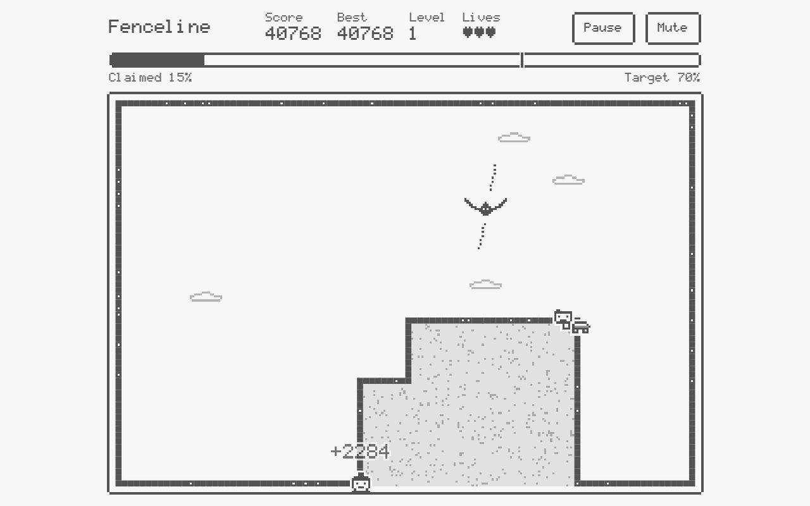
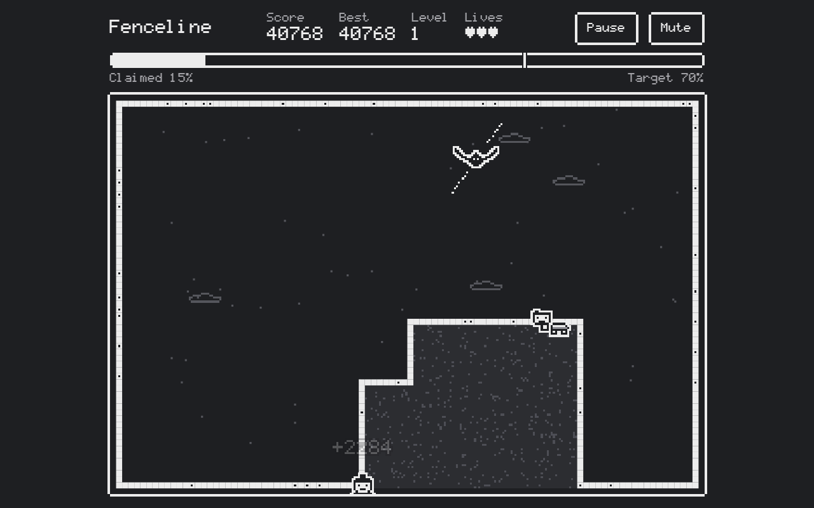
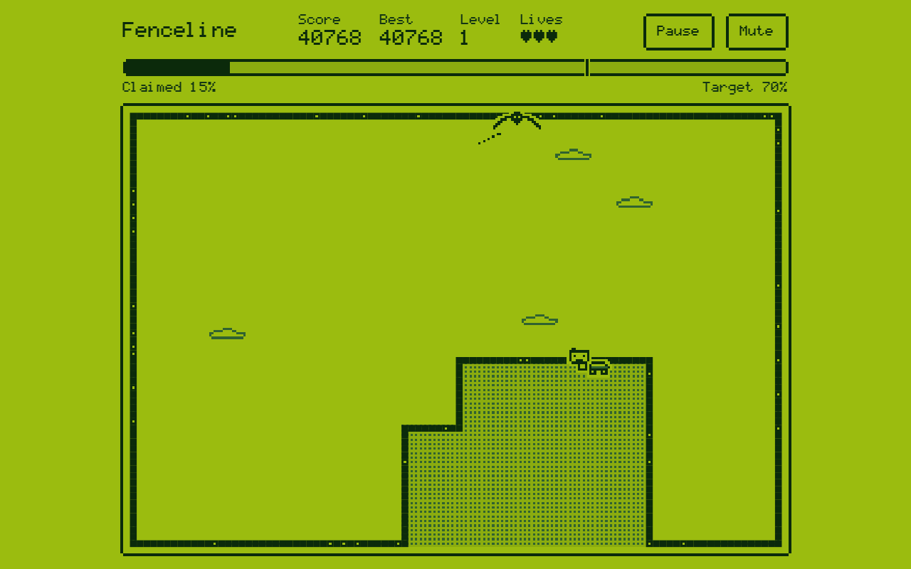
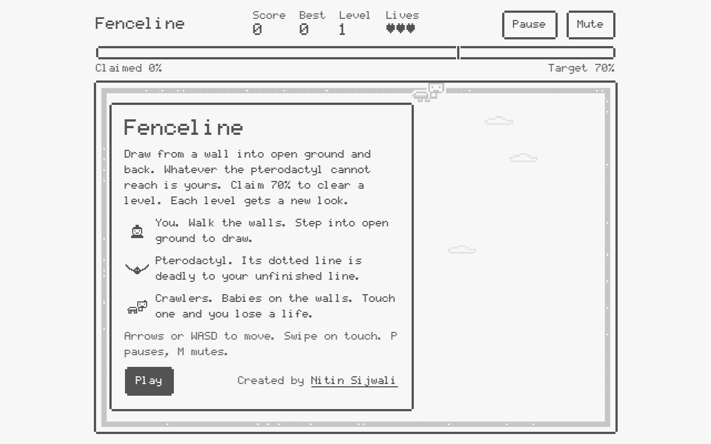
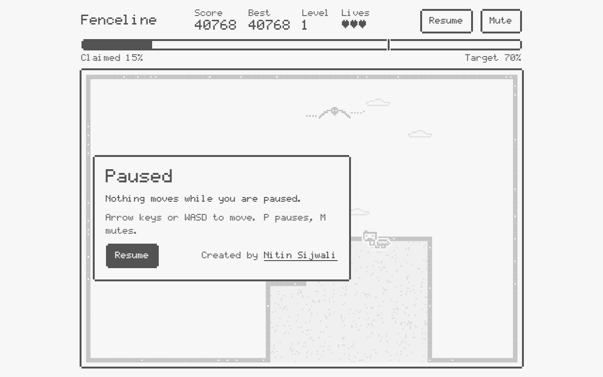
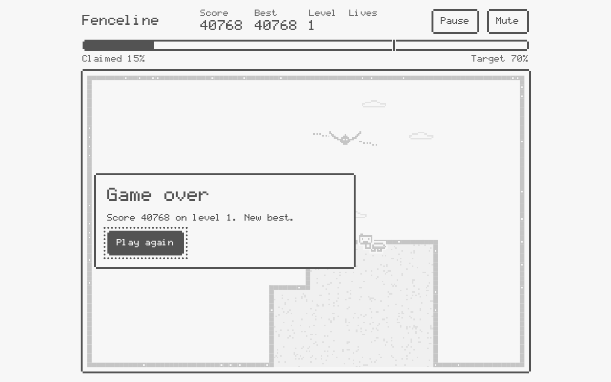
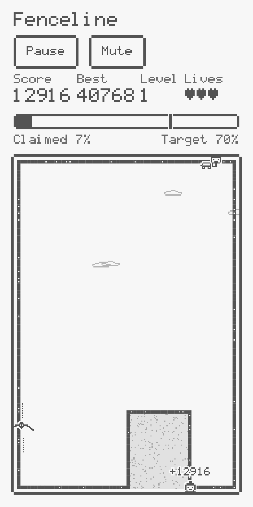

# Fenceline

**A free pixel territory game for your browser. No login, no ads, no network needed.**

Draw fences across open ground and claim land before the pterodactyl reaches your line. Built in a single HTML file with canvas, in the style of the offline dinosaur page.

**Play: https://fenceline.nitinsijwali.com**



## Contents
- [How to play](#how-to-play)
- [Controls](#controls)
- [The three looks](#the-three-looks)
- [Screens](#screens)
- [Music](#music)
- [Run locally](#run-locally)
- [Deploy](#deploy)
- [Project structure](#project-structure)
- [Technical notes](#technical-notes)

## How to play
1. Walk along the walls with your character.
2. Step into open ground to start drawing a line, then reach a wall again to close it.
3. Whatever the pterodactyl cannot reach becomes yours.
4. Claim the target percentage to clear the level. The target rises with each level.

| Element | What it does |
| --- | --- |
| You | Walks the walls and draws lines into open ground. |
| Pterodactyl | Flies in open ground. Its dotted line kills your unfinished line. More appear as levels rise. |
| Crawlers | Babies that crawl along the walls. Touching one costs a life. |
| Pillars | Solid blocks placed in open ground from level 2. They count as wall, so you can start and end lines on them. |

You have three lives. Bigger claims score more than several small ones. Your best score is saved in your browser.

## Controls
| Input | Action |
| --- | --- |
| Arrow keys or WASD | Move |
| Swipe, or the on-screen pad | Move on touch screens |
| P | Pause and resume |
| M | Mute and unmute |

## The three looks
The look changes every level: Day, Night, Handheld. Each has its own palette, land texture and music.

| Day | Night | Handheld |
| --- | --- | --- |
|  |  |  |

## Screens
| Title | Pause |
| --- | --- |
|  |  |

| Game over | Mobile |
| --- | --- |
|  |  |

## Music
The background music is built around a two-note whistled call, C sharp then A. It is generated live with WebAudio, so there are no audio files. Each look has its own arrangement:

| Look | Tempo | Lead sound |
| --- | --- | --- |
| Day | 92 BPM | Soft triangle with echo |
| Night | 72 BPM | Sine with echo |
| Handheld | 104 BPM | Pulse wave, no echo |

Use the Mute button or press M to turn it off.

## Run locally
There is nothing to install. Open `public/index.html` in a browser and press Play.

To serve it the way production does, with the same headers:

```sh
npx wrangler dev
```

## Deploy
The site is the `public/` folder, served as Cloudflare Workers static assets. `wrangler.jsonc` binds it to `fenceline.nitinsijwali.com`.

```sh
npx wrangler login
npx wrangler deploy
```

Pushes to `main` redeploy automatically through the Cloudflare Git integration. To use another domain, change the host in `wrangler.jsonc` and the URL in `public/index.html`, `public/robots.txt` and `public/sitemap.xml`.

## Project structure
```
public/
  index.html          the whole game: markup, CSS, JS and the pixel font
  sitemap.xml         submitted in Google Search Console
  robots.txt
  site.webmanifest
  _headers            security and cache headers
  404.html
  og-image.png        social sharing preview
  favicon.svg, favicon-32.png, apple-touch-icon.png, icon-192.png, icon-512.png
docs/screenshots/     images used in this README
wrangler.jsonc        Cloudflare Workers config
```

## Technical notes
- One file, no dependencies, no network calls. The pixel font is embedded as base64.
- The playfield is a 96 by 64 grid (64 by 96 in portrait). Claiming land is a flood fill from the pterodactyl cells; everything unreachable is claimed.
- Each look is a set of CSS custom properties, read once into the canvas palette.
- Sprites are drawn from small string maps at a third of a grid cell per pixel, with image smoothing off so edges stay sharp.
- Music is a WebAudio lookahead scheduler with no samples.

## Search and sharing
The page ships a canonical URL, Open Graph and Twitter tags, JSON-LD `VideoGame` data, a sitemap and `robots.txt`.

## Licence
MIT. See [LICENSE](LICENSE).

## Author
Created by [Nitin Sijwali](https://www.linkedin.com/in/nitinsij/).
